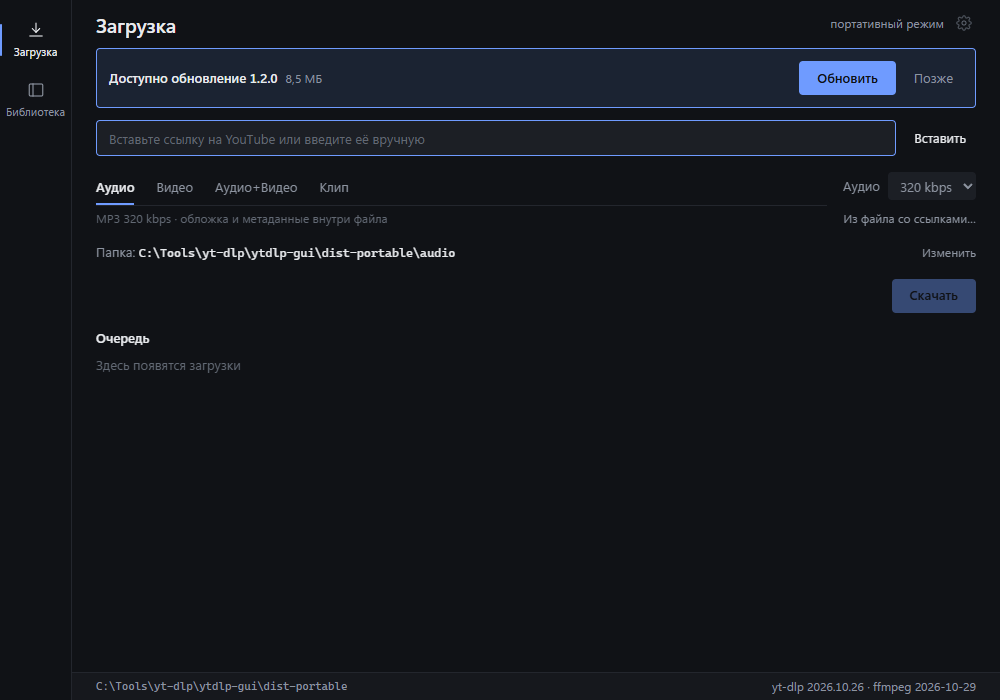

# Klipparkiv

**Portable GUI for yt-dlp on Windows and macOS** — save audio, video and timecode
clips, then keep them in a local library. No installer on Windows, no registry,
no admin rights.

**[English](#english)** · **[Русский](#русский)**

[](https://github.com/xmalinov/klipparkiv/actions/workflows/ci.yml)
[](LICENSE)

| Download | Library | Updates |
|:---:|:---:|:---:|
|  |  |  |

---

## English

*klipparkiv* (Swedish) — an archive of clippings.

### Features

- **Audio** — MP3 128–320 kbps with cover art and tags.
- **Video** — MP4 H.264/AAC 480p–2160p; plays in QuickTime and other system
  players (when H.264 is missing, the best available stream is used).
- **Audio + Video** — two files from one link, kept in separate archives.
- **Clips** — cut audio or video by timecode, e.g. `00:01:30-00:05:00`;
  open start/end, whole-video mode, live validation and range sliders.
- **Playlists** — download the whole list or only the linked video, with an
  optional range; files go into a folder named after the playlist.
- **Batch** — a `.txt` list or a pasted set of links; drag and drop links or a
  `.txt` file onto the window.
- **Queue** — titles, playlist progress (`2/42`), “already there” and “partial”
  states, 1–4 parallel downloads, pause, resume and cancel.
- **Metadata preview** — title, channel, duration, thumbnail, formats.
- **Download archive** — items you already saved are skipped (clips use
  deterministic filenames instead, so a second clip is not blocked).
- **Library** — covers, search, filters, sorting, open in the system player.
- **App updates** — in-app banner, signed download, restart on your command.
- **Update yt-dlp** from the UI.
- **Russian and English UI** — switch the language in Settings; the choice is saved.
- **Portable on Windows** — settings and index in `data\`, media in `audio\`
  and `video\`; nothing is written to the registry or `%APPDATA%`.
- **Native macOS app** — `.app` in a DMG; data lives in `~/Movies/Klipparkiv`.

### Requirements

- Windows 10/11 x64 with WebView2 (preinstalled).
- macOS 11+ on Intel or Apple Silicon.
- ~250 MB of disk space (plus the media you download).

### Install

**Windows**

1. Download `klipparkiv-<version>-win-x64.zip` from
   [Releases](https://github.com/xmalinov/klipparkiv/releases).
2. Unpack the folder completely — do not run the exe from inside the archive.
3. Run `klipparkiv.exe`.

The build is unsigned, so SmartScreen may warn you: **More info → Run anyway**.
The folder must be writable. FAT32 drives cannot store files over 4 GB — use
exFAT/NTFS.

**macOS**

1. Download `klipparkiv-<version>-mac-x64.dmg` (Intel) or
   `klipparkiv-<version>-mac-arm64.dmg` (Apple Silicon).
2. Open the DMG and drag Klipparkiv into Applications.
3. The app is ad-hoc signed, not notarized by Apple. On first launch:
   - macOS 15+: System Settings → Privacy & Security → **Open Anyway**;
   - macOS 14 and older: right-click Klipparkiv → **Open**.
   - Terminal alternative: `xattr -dr com.apple.quarantine /Applications/Klipparkiv.app`.
4. In-app updates do not require this confirmation again.

### Uninstall

**Windows** — delete the app folder. Settings and index live in `data\`, media
in `audio\` and `video\`; remove the folder to delete them too.

**macOS** — move Klipparkiv from Applications to the Bin, then delete
`~/Movies/Klipparkiv` (library, media and settings) and
`~/Library/Application Support/Klipparkiv` (binaries, updates, backups and logs).

### Build from source

Common: Node.js 24+, Rust stable, npm.

**Windows** (MSVC Build Tools, WebView2):

```powershell
npm ci
npm run tauri dev        # dev mode
npm run build:portable   # src-tauri\target\release\klipparkiv.exe
npm run pack:portable    # release\klipparkiv-<version>-win-x64.zip
```

**macOS** (Xcode Command Line Tools):

```bash
npm ci
npm run tauri dev        # dev mode
node scripts/fetch-binaries.mjs mac-arm64   # or mac-x64
npm run build:macos      # .app bundle
npm run pack:macos -- 1.6.0 arm64           # DMG + update archive
```

The app drives external binaries that are **not** in this repository.

Windows: put them in `bin\` next to the exe:

```
bin\yt-dlp.exe
bin\ffmpeg.exe
bin\ffprobe.exe
```

macOS: `node scripts/fetch-binaries.mjs mac-x64|mac-arm64` downloads pinned
`yt-dlp`, `ffmpeg` and `ffprobe` into `src-tauri/resources/bin`; they are
bundled into `Contents/Resources/bin`.

For the release and update-signing flow see [UPDATING.md](UPDATING.md).

Checks:

```powershell
npm run typecheck
npm run test:run
cargo test  --manifest-path src-tauri\Cargo.toml
cargo clippy --manifest-path src-tauri\Cargo.toml --all-targets -- -D warnings
```

### Project layout

| Path | Purpose |
|---|---|
| `src\` | React 19 + TypeScript frontend |
| `src-tauri\` | Rust backend: processes, progress, SQLite library |
| `scripts\` | portable and macOS packaging, update manifests, screenshots |
| `assets\screenshots\` | Images used in this README |

### Legal

Klipparkiv is a GUI: it runs [yt-dlp](https://github.com/yt-dlp/yt-dlp) (Unlicense)
and [FFmpeg](https://ffmpeg.org/legal.html) (LGPL/GPL depending on the build).
Download only content you own or are allowed to save; respect the terms of service
and the authors' copyright. Not affiliated with YouTube, Google, yt-dlp or FFmpeg.

### License

[MIT](LICENSE) © Klipparkiv contributors. See [CONTRIBUTING.md](CONTRIBUTING.md)
for setup and checks.

---

## Русский

*klipparkiv* (швед.) — архив вырезок.

### Возможности

- **Аудио** — MP3 128–320 кбит/с, с обложкой и тегами.
- **Видео** — MP4 H.264/AAC от 480p до 2160p; открывается в QuickTime и других
  системных плеерах (если H.264 нет, берётся лучший доступный поток).
- **Аудио + видео** — два файла по одной ссылке, в разных архивах.
- **Клипы** — вырезание аудио или видео по таймкоду, например `00:01:30-00:05:00`;
  открытые границы, режим «весь ролик», живая проверка и слайдеры.
- **Плейлисты** — весь список или только видео по ссылке, с диапазоном; файлы
  складываются в папку с названием плейлиста.
- **Пакетно** — `.txt` или вставленный список ссылок; drag & drop ссылок и `.txt`
  прямо в окно.
- **Очередь** — названия, прогресс плейлиста (`2/42`), статусы «Уже было» и
  «Частично», 1–4 параллельные загрузки, пауза, продолжение, отмена.
- **Предпросмотр** — название, канал, длительность, обложка, форматы.
- **Архив загрузок** — уже сохранённые элементы пропускаются (клипы не пишутся
  в архив: у них детерминированное имя, поэтому второй клип не блокируется).
- **Библиотека** — обложки, поиск, фильтры, сортировка, запуск в системном плеере.
- **Обновления приложения** — баннер в окне, подписанная загрузка, перезапуск по команде.
- **Обновление yt-dlp** из интерфейса.
- **Русский и английский интерфейс** — язык переключается в настройках и сохраняется.
- **Портативность** — настройки и индекс в `data\`, медиа в `audio\` и `video\`;
  реестр и `%APPDATA%` не затрагиваются.
- **Нативное приложение для macOS** — `.app` в DMG; данные в `~/Movies/Klipparkiv`.

### Требования

Windows 10/11 x64 · WebView2 (есть по умолчанию) · macOS 11+ (Intel или Apple
Silicon) · ~250 МБ на диске.

### Установка

**Windows**

1. Скачайте `klipparkiv-<версия>-win-x64.zip` со страницы
   [Releases](https://github.com/xmalinov/klipparkiv/releases).
2. Распакуйте папку целиком — не запускайте exe из архива.
3. Запустите `klipparkiv.exe`.

Сборка без подписи, поэтому SmartScreen может предупредить:
**«Подробнее» → «Выполнить в любом случае»**. Папка должна быть доступна для
записи. На FAT32 файлы больше 4 ГБ не поместятся — используйте exFAT/NTFS.

**macOS**

1. Скачайте `klipparkiv-<версия>-mac-x64.dmg` (Intel) или
   `klipparkiv-<версия>-mac-arm64.dmg` (Apple Silicon).
2. Откройте DMG и перетащите Klipparkiv в Applications.
3. Приложение подписано ad-hoc, но не нотаризовано Apple. При первом запуске:
   - macOS 15+: Системные настройки → Конфиденциальность и безопасность →
     **Открыть всё равно**;
   - macOS 14 и старше: правый клик по Klipparkiv → **Открыть**;
   - альтернатива в терминале: `xattr -dr com.apple.quarantine /Applications/Klipparkiv.app`.
4. Обновления из приложения больше не требуют этого подтверждения.

### Удаление

**Windows** — удалите папку приложения. Настройки и индекс лежат в `data\`,
медиа в `audio\` и `video\`; удалите папку целиком, чтобы стереть и их.

**macOS** — переместите Klipparkiv из Applications в Корзину, затем удалите
`~/Movies/Klipparkiv` (библиотека, медиа и настройки) и
`~/Library/Application Support/Klipparkiv` (бинарники, обновления, backup и логи).

### Сборка из исходников

Общее: Node.js 24+, Rust stable, npm.

**Windows** (MSVC Build Tools, WebView2):

```powershell
npm ci
npm run tauri dev        # режим разработки
npm run build:portable   # src-tauri\target\release\klipparkiv.exe
npm run pack:portable    # release\klipparkiv-<версия>-win-x64.zip
```

**macOS** (Xcode Command Line Tools):

```bash
npm ci
npm run tauri dev        # режим разработки
node scripts/fetch-binaries.mjs mac-arm64   # или mac-x64
npm run build:macos      # .app bundle
npm run pack:macos -- 1.6.0 arm64           # DMG + архив обновления
```

Приложению нужны внешние бинарники, которых **нет** в репозитории.

Windows: положите их в `bin\` рядом с exe:

```
bin\yt-dlp.exe
bin\ffmpeg.exe
bin\ffprobe.exe
```

macOS: `node scripts/fetch-binaries.mjs mac-x64|mac-arm64` скачивает
зафиксированные `yt-dlp`, `ffmpeg` и `ffprobe` в `src-tauri/resources/bin`;
они попадают в `Contents/Resources/bin`.

Процесс релиза и подписи обновлений описан в [UPDATING.md](UPDATING.md).

Проверки:

```powershell
npm run typecheck
npm run test:run
cargo test  --manifest-path src-tauri\Cargo.toml
cargo clippy --manifest-path src-tauri\Cargo.toml --all-targets -- -D warnings
```

### Структура

| Путь | Назначение |
|---|---|
| `src\` | фронтенд на React 19 + TypeScript |
| `src-tauri\` | бэкенд на Rust: процессы, прогресс, библиотека на SQLite |
| `scripts\` | упаковка portable и macOS, манифесты обновлений, скриншоты |
| `assets\screenshots\` | изображения для этого README |

### Правовое

Klipparkiv — только интерфейс: он запускает [yt-dlp](https://github.com/yt-dlp/yt-dlp)
(Unlicense) и [FFmpeg](https://ffmpeg.org/legal.html) (LGPL/GPL в зависимости от
сборки). Скачивайте только тот контент, на который у вас есть права; соблюдайте
условия сервисов и авторские права. Проект не связан с YouTube, Google, yt-dlp
и FFmpeg.

### Лицензия

[MIT](LICENSE) © Klipparkiv contributors. Настройка и проверки описаны в
[CONTRIBUTING.md](CONTRIBUTING.md).
