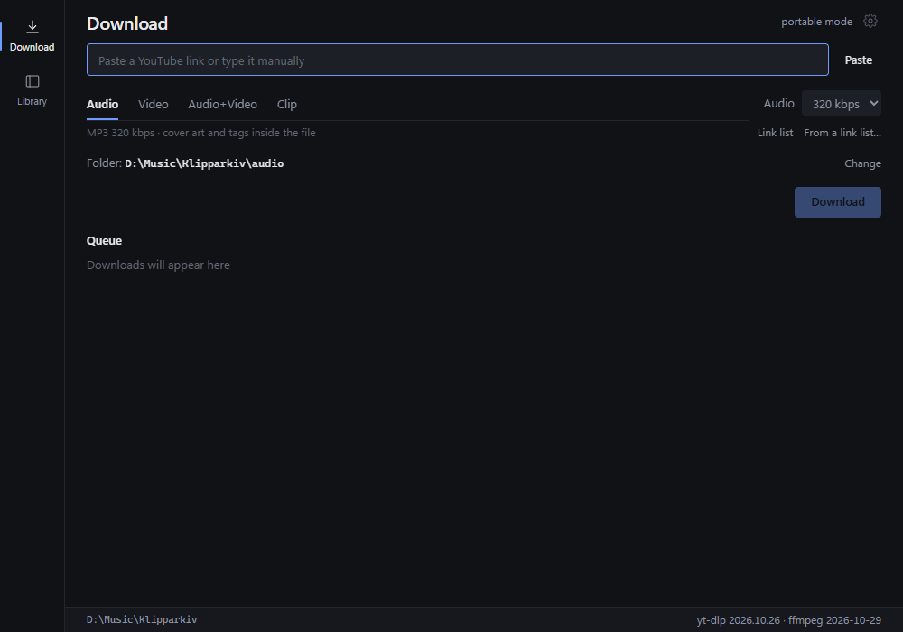
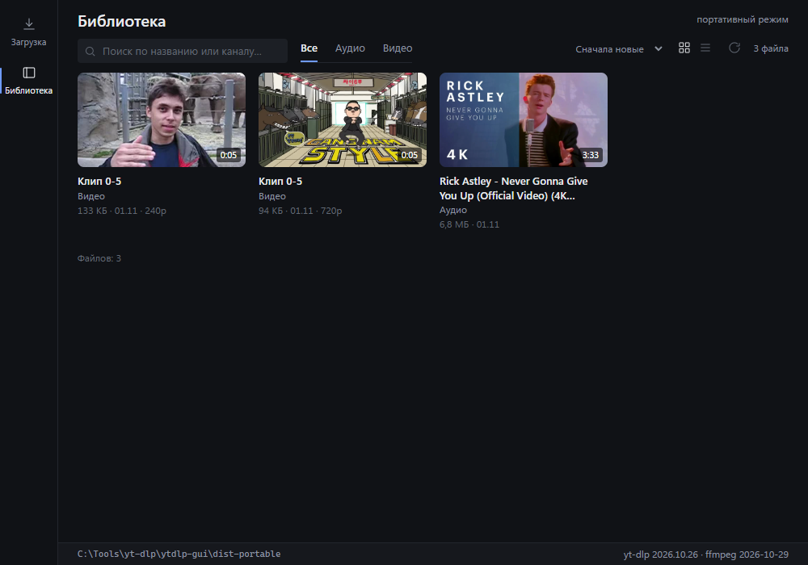
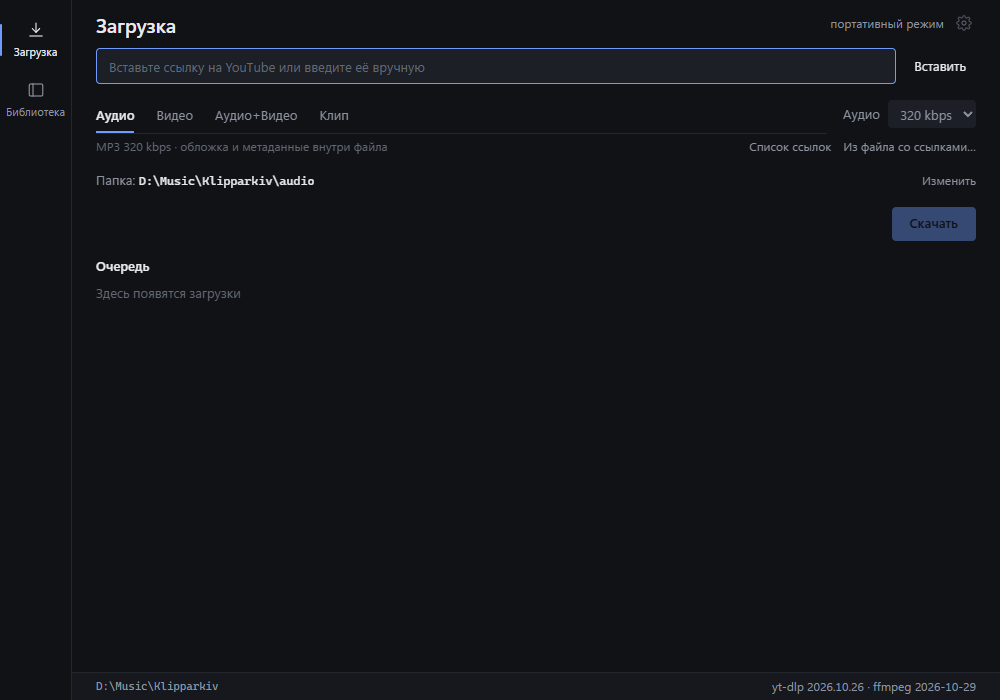
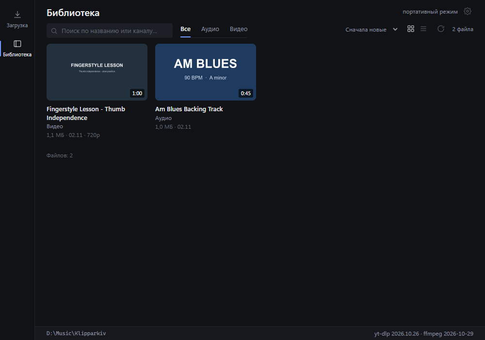

# Klipparkiv

**An offline library for backing tracks, lessons and timecode clips.**
Klipparkiv is a desktop front end for yt-dlp: save audio, video, clips and
playlists, then keep them in a local library. Portable on Windows, a native app
on macOS.

**[English](#english)** · **[Русский](#русский)**

[](https://github.com/xmalinov/klipparkiv/actions/workflows/ci.yml)
[](LICENSE)

Klipparkiv does not host, index or distribute media. Use it only for content you
own, have permission to save, or that is offered under a license that allows
downloading. See [Legal](#legal).

| Download | Library |
|:---:|:---:|
|  |  |

---

## English

*Klipparkiv* (Swedish) — an archive of clippings.

**Release notes:** [CHANGELOG.md](CHANGELOG.md). **Security:** [SECURITY.md](SECURITY.md).
**Privacy:** [PRIVACY.md](PRIVACY.md). **Third-party licenses:**
[THIRD_PARTY_NOTICES.md](THIRD_PARTY_NOTICES.md).

### Start here

#### 1. Download the right file

| Platform | File | Notes |
|---|---|---|
| Windows 10/11 x64 | `klipparkiv-<version>-win-x64.zip` | Portable. Unpack the whole folder. |
| macOS 11+, Apple Silicon | `klipparkiv-<version>-mac-arm64.dmg` | M1, M2, M3, M4 and newer. |
| macOS 11+, Intel | `klipparkiv-<version>-mac-x64.dmg` | Intel Macs. |

On a Mac, check **Apple menu → About This Mac → Chip / Processor** if you are not
sure which DMG you need.

**Do not download these for a first install:**

- `klipparkiv-<version>-win-x64.exe` — the update payload used by the in-app
  updater, not a portable build;
- `klipparkiv-<version>-mac-*.app.tar.gz` — the in-app update archive;
- any `.sig` file or `update.json` — signatures and the update manifest.

#### 2. Install

**Windows**

1. Download the `.zip`.
2. Unpack the folder completely. Do not run the exe from inside the archive.
3. Run `klipparkiv.exe`.
4. SmartScreen may warn because the build is unsigned: **More info → Run
   anyway**. The folder must be writable. Use exFAT or NTFS for files over 4 GB.

**macOS**

1. Download the DMG that matches your Mac.
2. Open it and drag **Klipparkiv** into **Applications** (Программы).
3. The app is ad-hoc signed, not notarized by Apple. On first launch:
   - macOS 15+: **System Settings → Privacy & Security → Open Anyway**;
   - macOS 14 and older: right-click Klipparkiv → **Open**;
   - if neither works, run in Terminal:
     `xattr -dr com.apple.quarantine /Applications/Klipparkiv.app`.
4. In-app updates do not ask for this confirmation again.

#### 3. Use it

1. Paste a link that yt-dlp supports.
2. Wait for the metadata preview: title, channel, duration, thumbnail, formats.
3. Choose **Audio**, **Video**, **Audio + Video** or **Clip**.
4. Pick a destination folder and press **Download**.
5. Open **Library** to search, filter and open a saved file in your system player,
   or open audio in **Practice**.

For a clip, enter a timecode such as `00:01:30-00:05:00`, or leave one side open
to cut from the start or to the end. For a playlist, choose the whole list or only
the linked video, optionally with an item range.

Audio files open in the built-in **Practice** player: slow down, change pitch,
loop a phrase, follow the beat grid and metronome, and mark sections. Video
files and the system player are unchanged.

### Features

- **Audio** — MP3 128–320 kbps with cover art and tags.
- **Video** — MP4 H.264/AAC 480p–2160p when the source provides it; if H.264 is
  missing, the best available stream is used and some players may not open it.
- **Clips** — cut audio or video by timecode, with open start/end, whole-video
  mode, live validation and range sliders.
- **Playlists** — download the whole list or only the linked video, with an
  optional range; files go into a folder named after the playlist.
- **Batch** — a `.txt` list or a pasted set of links; drag and drop links or a
  `.txt` file onto the window.
- **Queue** — titles, playlist progress (`2/42`), "already there" and "partial"
  states, up to 4 parallel downloads, pause, resume and cancel.
- **Metadata preview** — title, channel, duration, thumbnail, formats.
- **Download archive** — items you already saved are skipped (clips use
  deterministic filenames instead, so a second clip is not blocked).
- **Library** - covers, search, filters, sorting, open in Practice or the system player.
- **Import local files** - drag audio or video from Explorer/Finder into the
  Library, or into Practice to copy and open the first audio paused. Files are
  copied into `audio/`/`video/`, tags and covers are read, duplicates are skipped;
  the **Add files…** dialog does the same without dragging.
- **Practice** - audio-only player: 0.25–2.0 speed, ±12 semitones, volume,
  A-B loops, named regions, BPM/beat grid, bar-snapped loops, metronome and
  count-in, waveform with zoom, keyboard shortcuts and a mini-player.
- **App updates** — in-app banner, download verified with a Minisign signature,
  restart on your command.
- **Update yt-dlp** from the UI.
- **Russian and English UI** — switch the language in Settings; the choice is saved.
- **Portable on Windows** — app data in `data\`, media in `audio\` and `video\`.
  WebView2 may keep its own cache in `%LOCALAPPDATA%`.
- **Native macOS app** — `.app` in a DMG; library and media in
  `~/Movies/Klipparkiv`, settings and updates in
  `~/Library/Application Support/Klipparkiv`.

### Requirements

- Windows 10/11 x64 with WebView2. It is usually preinstalled, but not guaranteed
  on every edition; if it is missing, install the
  [Evergreen Runtime](https://developer.microsoft.com/microsoft-edge/webview2/).
- macOS 11+ on Intel or Apple Silicon.
- About 110–115 MB to download and about 253 MB on disk, plus your media.
- A folder the app can write to.

### Troubleshooting

**"Not found in bin" or "could not start yt-dlp".** The app reads
`yt-dlp.exe`, `ffmpeg.exe` and `ffprobe.exe` from the `bin` folder next to
`klipparkiv.exe`. Since 1.6.2 the banner names the exact path and the Windows
error for every file it cannot use.

- If the path points to a temporary folder, the exe was started from inside the
  ZIP. Quit the app from the tray, unpack the whole archive and run
  `klipparkiv.exe` from the unpacked folder.
- If `bin` is missing, unpack the archive again. Do not move the exe alone.
- If the files exist but the error mentions access or a damaged file, add the
  app folder to the antivirus exclusions, restore the file from quarantine and
  download the release zip again.
- After moving or renaming the app folder, quit it completely (tray → **Quit**)
  and start it from the new location; a running instance keeps the old path.
- The in-app yt-dlp update refreshes an existing file; it cannot restore a
  deleted `bin` folder.

### Uninstall

**Windows** — delete the app folder. Settings and the index live in `data\`,
media in `audio\` and `video\`; remove the folder to delete them too.

**macOS** — move Klipparkiv from Applications to the Bin, then delete
`~/Movies/Klipparkiv` (library, media and settings) and
`~/Library/Application Support/Klipparkiv` (binaries, updates, backups and logs).

### Data and privacy

Klipparkiv has no accounts, no telemetry, no analytics and no advertising.

Network access happens only for:

- downloads and metadata through yt-dlp, for the links you paste;
- yt-dlp updates from the yt-dlp GitHub releases;
- app updates from the Klipparkiv GitHub releases.

The app does not upload your library, file names, listening history or settings.
Logs stay local and can contain URLs, titles and paths; remove anything private
before sharing a log. The GitHub Pages site uses no analytics and sets no
cookies. See [PRIVACY.md](PRIVACY.md).

### Legal

Klipparkiv is a local GUI for yt-dlp. It does not host, index, stream or
distribute content.

Use it only for media you own, have permission to save, or that is offered under
a license that allows downloading. Respect the source site's terms of service
and copyright law. Do not use Klipparkiv to bypass paywalls, DRM or access
controls.

Klipparkiv is not affiliated with YouTube, Google, yt-dlp or FFmpeg. yt-dlp is a
separate open-source project (Unlicense). FFmpeg is a separate project; the
bundled Windows build is GPLv3 and the macOS build keeps the license of its
build. Klipparkiv's own code is MIT-licensed; bundled binaries are not
relicensed by it. Full texts and source links are in
[THIRD_PARTY_NOTICES.md](THIRD_PARTY_NOTICES.md) and [LICENSES/](LICENSES/).

This notice is practical information, not legal advice.

### Security

Report vulnerabilities privately through the repository's **Security** tab. Do
not open a public issue and do not include cookies, tokens or private URLs. See
[SECURITY.md](SECURITY.md).

### Build from source

Common: Node.js 24+, Rust stable, npm.

**Windows** (MSVC Build Tools, WebView2):

```powershell
npm ci
npm run models:fetch     # Beat This! beat-grid models
npm run tauri dev        # dev mode
npm run build:portable   # src-tauri\target\release\klipparkiv.exe
npm run pack:portable    # release\klipparkiv-<version>-win-x64.zip
```

**macOS** (Xcode Command Line Tools):

```bash
npm ci
npm run tauri dev        # dev mode
node scripts/fetch-binaries.mjs mac-arm64   # or mac-x64
node scripts/fetch-models.mjs               # Beat This! models
npm run build:macos      # .app bundle
npm run pack:macos -- <version> arm64       # DMG + update archive
```

The app drives external binaries that are **not** in this repository.

Windows: put them in `bin\` next to the exe:

```
bin\yt-dlp.exe
bin\ffmpeg.exe
bin\ffprobe.exe
```

macOS: `node scripts/fetch-binaries.mjs mac-x64|mac-arm64` downloads pinned
`yt-dlp`, `ffmpeg` and `ffprobe` into `src-tauri/resources/bin`; they are
bundled into `Contents/Resources/bin`.

For the release and update-signing flow see [UPDATING.md](UPDATING.md).

Checks:

```powershell
npm run typecheck
npm run test:run
npm run build
cargo fmt    --manifest-path src-tauri\Cargo.toml -- --check
cargo clippy --manifest-path src-tauri\Cargo.toml --all-targets -- -D warnings
cargo test   --manifest-path src-tauri\Cargo.toml
node scripts/check-version.mjs
```

### Project layout

| Path | Purpose |
|---|---|
| `src\` | React 19 + TypeScript frontend |
| `src-tauri\` | Rust backend: processes, progress, SQLite library |
| `scripts\` | portable and macOS packaging, update manifests, screenshots |
| `assets\screenshots\` | Images used in this README |
| `docs\` | Internal design notes, not user documentation |
| `SECURITY.md`, `PRIVACY.md`, `THIRD_PARTY_NOTICES.md` | Policies and legal notices |
| `LICENSES\` | Full texts for bundled third-party licenses |

### License

[MIT](LICENSE) © Klipparkiv contributors. See [CONTRIBUTING.md](CONTRIBUTING.md)
for setup and checks. Bundled components keep their own licenses; see
[THIRD_PARTY_NOTICES.md](THIRD_PARTY_NOTICES.md).

---

## Русский

*Klipparkiv* (швед.) — архив вырезок.

**Список изменений:** [CHANGELOG.md](CHANGELOG.md). **Безопасность:**
[SECURITY.md](SECURITY.md). **Конфиденциальность:** [PRIVACY.md](PRIVACY.md).
**Лицензии компонентов:** [THIRD_PARTY_NOTICES.md](THIRD_PARTY_NOTICES.md).

| Загрузка | Библиотека |
|:---:|:---:|
|  |  |

### Начните здесь

#### 1. Скачайте нужный файл

| Платформа | Файл | Примечание |
|---|---|---|
| Windows 10/11 x64 | `klipparkiv-<версия>-win-x64.zip` | Портативная сборка. Распакуйте папку целиком. |
| macOS 11+, Apple Silicon | `klipparkiv-<версия>-mac-arm64.dmg` | M1, M2, M3, M4 и новее. |
| macOS 11+, Intel | `klipparkiv-<версия>-mac-x64.dmg` | Mac на Intel. |

Если не уверены, какой DMG нужен: **меню Apple → «Об этом Mac» → «Чип» или
«Процессор»**.

**Не скачивайте для первой установки:**

- `klipparkiv-<версия>-win-x64.exe` — это файл встроенного обновления, а не
  портативная сборка;
- `klipparkiv-<версия>-mac-*.app.tar.gz` — архив для встроенного обновления;
- `.sig` и `update.json` — подписи и манифест обновления.

#### 2. Установите

**Windows**

1. Скачайте `.zip`.
2. Распакуйте папку целиком. Не запускайте exe из архива.
3. Запустите `klipparkiv.exe`.
4. SmartScreen может предупредить, потому что сборка без подписи:
   **«Подробнее» → «Выполнить»**. Папка должна быть доступна для записи.
   Для файлов больше 4 ГБ используйте exFAT или NTFS.

**macOS**

1. Скачайте DMG для своего Mac.
2. Откройте его и перетащите **Klipparkiv** в **Applications** («Программы»).
3. Приложение подписано ad-hoc, но не нотаризовано Apple. При первом запуске:
   - macOS 15+: **Системные настройки → Конфиденциальность и безопасность →
     «Всё равно открыть»**;
   - macOS 14 и старше: правый клик по Klipparkiv → **«Открыть»**;
   - если не помогает, выполните в Terminal:
     `xattr -dr com.apple.quarantine /Applications/Klipparkiv.app`.
4. Обновления из приложения больше не требуют этого подтверждения.

#### 3. Пользуйтесь

1. Вставьте ссылку, которую поддерживает yt-dlp.
2. Дождитесь предпросмотра: название, канал, длительность, обложка, форматы.
3. Выберите **«Аудио»**, **«Видео»**, **«Аудио + видео»** или **«Клип»**.
4. Укажите папку и нажмите **«Скачать»**.
5. Откройте **«Библиотеку»**, чтобы искать, фильтровать и открывать файл в
   системном плеере или в **Practice**.

Для клипа введите таймкод, например `00:01:30-00:05:00`, или оставьте одну
границу пустой, чтобы резать от начала или до конца. Для плейлиста выберите
весь список или только видео по ссылке, при необходимости с диапазоном.

Аудио открывается во встроенном плеере **Practice**: замедление, смена тона,
луп фразы, сетка долей и метроном, разметка секций. Видео и системный плеер
работают как раньше.

### Возможности

- **Аудио** — MP3 128–320 кбит/с, с обложкой и тегами.
- **Видео** — MP4 H.264/AAC 480p–2160p, если источник его отдаёт; если H.264
  нет, берётся лучший доступный поток, и некоторые плееры могут его не открыть.
- **Клипы** — вырезание аудио или видео по таймкоду, открытые границы, режим
  «весь ролик», живая проверка и слайдеры.
- **Плейлисты** — весь список или только видео по ссылке, с диапазоном; файлы
  складываются в папку с названием плейлиста.
- **Пакетно** — `.txt` или вставленный список ссылок; drag & drop ссылок и `.txt`
  прямо в окно.
- **Очередь** — названия, прогресс плейлиста (`2/42`), статусы «Уже было» и
  «Частично», до 4 параллельных загрузок, пауза, продолжение, отмена.
- **Предпросмотр** — название, канал, длительность, обложка, форматы.
- **Архив загрузок** — уже сохранённые элементы пропускаются (клипы не пишутся
  в архив: у них детерминированное имя, поэтому второй клип не блокируется).
- **Библиотека** — обложки, поиск, фильтры, сортировка, запуск в Practice или
  системном плеере.
- **Practice** — плеер только для аудио: скорость 0.25–2.0, ±12 полутонов,
  громкость, A-B лупы, именованные регионы, BPM и сетка долей, лупы по тактам,
  метроном и отсчёт, волна с зумом, горячие клавиши и мини-плеер.
- **Обновления приложения** — баннер в окне, загрузка с проверкой подписи
  Minisign, перезапуск по команде.
- **Обновление yt-dlp** из интерфейса.
- **Русский и английский интерфейс** — язык переключается в настройках и
  сохраняется.
- **Портативность на Windows** — данные приложения в `data\`, медиа в `audio\`
  и `video\`. WebView2 может держать свой кэш в `%LOCALAPPDATA%`.
- **Нативное приложение для macOS** — `.app` в DMG; библиотека и медиа в
  `~/Movies/Klipparkiv`, настройки и обновления в
  `~/Library/Application Support/Klipparkiv`.

### Требования

- Windows 10/11 x64 с WebView2. Обычно он есть, но не гарантирован в каждой
  редакции; если его нет, установите
  [Evergreen Runtime](https://developer.microsoft.com/microsoft-edge/webview2/).
- macOS 11+ на Intel или Apple Silicon.
- Около 110–115 МБ на скачивание и около 253 МБ на диске, плюс ваши медиа.
- Папка с правом записи.

### Если что-то не работает

**«В папке … не найдены…» или «не удалось запустить yt-dlp».** Приложение читает
`yt-dlp.exe`, `ffmpeg.exe` и `ffprobe.exe` из папки `bin` рядом с
`klipparkiv.exe`. Начиная с 1.6.2 предупреждение показывает точный путь и ошибку
Windows для каждого файла, который не удалось использовать.

- Если путь ведёт во временную папку, exe запущен из ZIP. Выйдите из приложения
  через трей, распакуйте архив целиком и запустите `klipparkiv.exe` из
  распакованной папки.
- Если папки `bin` нет, распакуйте архив заново. Не переносите один exe.
- Если файлы есть, но ошибка говорит о доступе или повреждении, добавьте папку
  приложения в исключения антивируса, восстановите файл из карантина и скачайте
  архив релиза заново.
- После переноса или переименования папки полностью закройте приложение
  (трей → **«Выход»**) и запустите его из нового места: работающий экземпляр
  сохраняет старый путь.
- Обновление yt-dlp из настроек обновляет существующий файл и не восстановит
  удалённую папку `bin`.

### Удаление

**Windows** — удалите папку приложения. Настройки и индекс лежат в `data\`,
медиа в `audio\` и `video\`; удалите папку целиком, чтобы стереть и их.

**macOS** — переместите Klipparkiv из Applications в Корзину, затем удалите
`~/Movies/Klipparkiv` (библиотека, медиа и настройки) и
`~/Library/Application Support/Klipparkiv` (бинарники, обновления, резервные
копии и логи).

### Данные и конфиденциальность

В Klipparkiv нет аккаунтов, телеметрии, аналитики и рекламы.

Сеть используется только для:

- загрузок и метаданных через yt-dlp по вашим ссылкам;
- обновления yt-dlp из GitHub Releases;
- обновлений приложения из GitHub Releases.

Приложение не выгружает библиотеку, имена файлов, историю или настройки. Логи
остаются локально и могут содержать ссылки, названия и пути; удалите лишнее
перед отправкой лога. Сайт на GitHub Pages не использует аналитику и не ставит
cookies. Подробнее — [PRIVACY.md](PRIVACY.md).

### Правовое

Klipparkiv — локальный интерфейс к yt-dlp. Он не хранит, не индексирует, не
транслирует и не распространяет контент.

Используйте его только для медиа, которое вам принадлежит, которое разрешено
сохранять или которое распространяется по лицензии, допускающей скачивание.
Соблюдайте условия сервисов и авторские права. Не используйте Klipparkiv для
обхода платного доступа, DRM или технических ограничений.

Klipparkiv не связан с YouTube, Google, yt-dlp или FFmpeg. yt-dlp — отдельный
open-source проект (Unlicense). FFmpeg — отдельный проект; встроенная сборка для
Windows распространяется по GPLv3, сборка для macOS сохраняет лицензию своей
сборки. Код Klipparkiv распространяется по MIT; встроенные бинарники это не
перелицензирует. Полные тексты и ссылки на исходники —
[THIRD_PARTY_NOTICES.md](THIRD_PARTY_NOTICES.md) и [LICENSES/](LICENSES/).

Это практическая информация, а не юридическая консультация.

### Безопасность

Об уязвимостях сообщайте приватно через вкладку **Security** репозитория. Не
открывайте публичный issue и не прикладывайте cookies, токены и приватные
ссылки. См. [SECURITY.md](SECURITY.md).

### Сборка из исходников

Общее: Node.js 24+, Rust stable, npm.

**Windows** (MSVC Build Tools, WebView2):

```powershell
npm ci
npm run models:fetch     # модели сетки Beat This!
npm run tauri dev        # режим разработки
npm run build:portable   # src-tauri\target\release\klipparkiv.exe
npm run pack:portable    # release\klipparkiv-<версия>-win-x64.zip
```

**macOS** (Xcode Command Line Tools):

```bash
npm ci
npm run tauri dev        # режим разработки
node scripts/fetch-binaries.mjs mac-arm64   # или mac-x64
npm run build:macos      # .app bundle
npm run pack:macos -- <версия> arm64        # DMG + архив обновления
```

Приложению нужны внешние бинарники, которых **нет** в репозитории.

Windows: положите их в `bin\` рядом с exe:

```
bin\yt-dlp.exe
bin\ffmpeg.exe
bin\ffprobe.exe
```

macOS: `node scripts/fetch-binaries.mjs mac-x64|mac-arm64` скачивает
зафиксированные `yt-dlp`, `ffmpeg` и `ffprobe` в `src-tauri/resources/bin`;
они попадают в `Contents/Resources/bin`.

Процесс релиза и подписи обновлений описан в [UPDATING.md](UPDATING.md).

Проверки:

```powershell
npm run typecheck
npm run test:run
npm run build
cargo fmt    --manifest-path src-tauri\Cargo.toml -- --check
cargo clippy --manifest-path src-tauri\Cargo.toml --all-targets -- -D warnings
cargo test   --manifest-path src-tauri\Cargo.toml
node scripts/check-version.mjs
```

### Структура

| Путь | Назначение |
|---|---|
| `src\` | фронтенд на React 19 + TypeScript |
| `src-tauri\` | бэкенд на Rust: процессы, прогресс, библиотека на SQLite |
| `scripts\` | упаковка portable и macOS, манифесты обновлений, скриншоты |
| `assets\screenshots\` | изображения для этого README |
| `docs\` | внутренние заметки по разработке, не документация для пользователя |
| `SECURITY.md`, `PRIVACY.md`, `THIRD_PARTY_NOTICES.md` | политики и правовые уведомления |
| `LICENSES\` | полные тексты лицензий сторонних компонентов |

### Лицензия

[MIT](LICENSE) © Klipparkiv contributors. Настройка и проверки описаны в
[CONTRIBUTING.md](CONTRIBUTING.md). Встроенные компоненты сохраняют свои
лицензии; см. [THIRD_PARTY_NOTICES.md](THIRD_PARTY_NOTICES.md).
