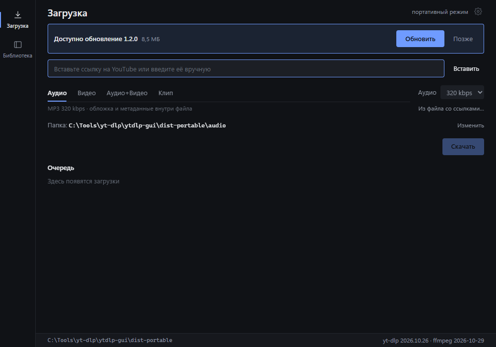
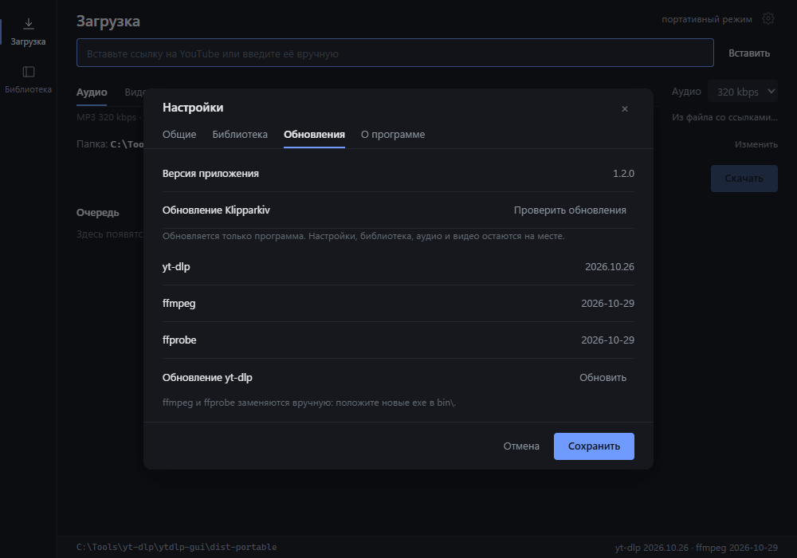

# Klipparkiv updates

The app checks a signed `update.json` from GitHub Releases and replaces only
`klipparkiv.exe`. Settings, the library, `audio\` and `video\` are never touched.

The first release that contains the updater is **1.2.0**. There are no older
public versions, so no migration/manual-update step is needed.





## Release flow

Pushing a `v*` tag runs `.github/workflows/release.yml`, which builds, signs and
verifies the update, then creates a **draft** release. Publish it with
`gh release edit v<version> --draft=false`.

The manual flow below is the fallback for a local release.

1. Bump the version in `package.json`, `src-tauri/Cargo.toml` and
   `src-tauri/tauri.conf.json`. They must match; the release workflow checks the
   tag against `package.json`.
2. Build and pack:

   ```powershell
   npm run build:portable
   npm run pack:portable
   ```

3. Create the updater asset and signature:

   ```powershell
   $version = (Get-Content package.json -Raw | ConvertFrom-Json).version
   Copy-Item dist-portable\klipparkiv.exe "release\klipparkiv-$version-win-x64.exe"
   npx tauri signer sign -f .secrets\klipparkiv-updater.key `
     --app-version $version "release\klipparkiv-$version-win-x64.exe"
   ```

4. Generate the manifest:

   ```powershell
   ./scripts/make-update-manifest.ps1 `
     -Version $version `
     -Exe "release\klipparkiv-$version-win-x64.exe" `
     -Signature "release\klipparkiv-$version-win-x64.exe.sig" `
     -Url "https://github.com/xmalinov/klipparkiv/releases/download/v$version/klipparkiv-$version-win-x64.exe" `
     -Out "release/update.json"
   ```

5. Tag `v<version>`, push the tag and publish the draft release. Until the
   release is published, `releases/latest/download/update.json` still points to
   the previous version.

## Signing key

`src-tauri/update.pub` is the embedded public key. The matching private key was
generated into `.secrets/klipparkiv-updater.key` (gitignored). **Back it up.**
If it is lost, already installed clients cannot verify future updates.

GitHub Actions needs it as a repository secret:

- `TAURI_SIGNING_PRIVATE_KEY` — the literal contents of
  `.secrets/klipparkiv-updater.key`
- `TAURI_SIGNING_PRIVATE_KEY_PASSWORD` — empty for the generated key

Local builds without a private key still compile, but cannot produce a valid
release manifest.

## Security properties

- The exe is verified with Ed25519/minisign before it is staged.
- The signature binds the artifact to the version in its trusted comment, so a
  tampered manifest cannot pair a newer version with an older signed binary.
- SHA-256 is checked as an additional integrity guard.
- Downgrades and versions not newer than the running app are ignored.
- The helper validates that it only replaces files inside the portable root.
- Updating from a version older than the first release with this updater
  requires one manual download.
